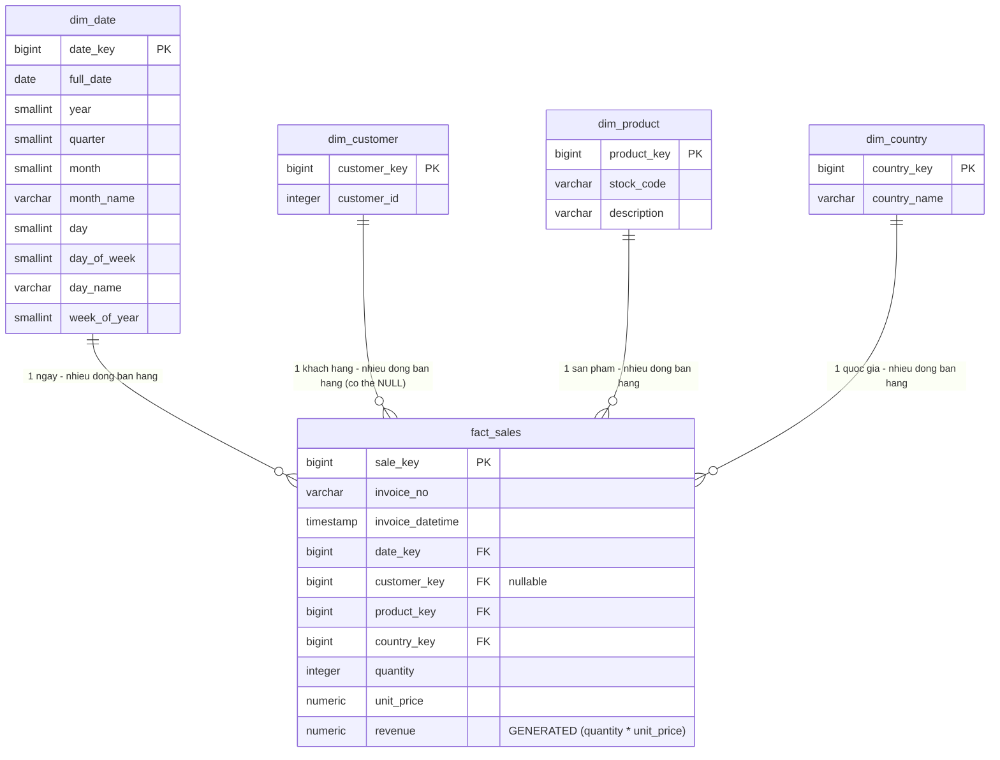

# Phase 3.1 — Thiết kế Star Schema (PostgreSQL Data Warehouse)

Trạng thái: **thiết kế + DDL, chưa nạp dữ liệu nghiệp vụ** (Phase 3.3 — xác thực sau nạp —
chưa thực hiện). DDL tương ứng: [`sql/001_create_star_schema.sql`](../sql/001_create_star_schema.sql).

Căn cứ thiết kế: khảo sát thực tế dataset Online Retail II đã chạy lại và xác minh trong lượt
này (không suy đoán):

| Cột gốc | Null | Max length / phạm vi |
|---|---|---|
| `Invoice` | 0 | độ dài tối đa 7 ký tự (gồm cả tiền tố `C` của đơn hủy) |
| `StockCode` | 0 | độ dài tối đa 12 ký tự |
| `Description` | 4,382 (0.41%) | độ dài tối đa 35 ký tự |
| `Quantity` | 0 | **không có dòng nào = 0**; có 22,950 dòng âm (đơn hủy/trả hàng) |
| `InvoiceDate` | 0 | 2009-12-01 → 2011-12-09 |
| `Price` | 0 | 6,202 dòng = 0; **chỉ 5 dòng âm** |
| `Customer ID` | 243,007 (22.77%) | phạm vi 12,346–18,287 |
| `Country` | 0 | 43 quốc gia duy nhất, độ dài tối đa 20 ký tự |

---

## 1. Grain của `fact_sales`

**1 dòng = 1 dòng hàng (line item) trong 1 hóa đơn** — tức 1 cặp `(Invoice, StockCode)` tại
1 vị trí dòng cụ thể trong file gốc, **không phải 1 hóa đơn tổng hợp**.

Lý do cần khóa surrogate riêng cho `fact_sales` (không dùng `(Invoice, StockCode)` làm khóa):
đã xác minh thực tế có **42,638 / 1,021,424** cặp `(Invoice, StockCode)` xuất hiện **nhiều hơn
1 dòng** trong dataset gốc (ví dụ do lô hàng ghi tách dòng) → `(Invoice, StockCode)` không phải
khóa duy nhất ở mức dòng, nên `fact_sales` dùng `sale_key` surrogate riêng.

## 2. Các bảng và thuộc tính chính

### `dim_date` — chiều ngày (grain: 1 dòng = 1 ngày lịch)
`date_key` (surrogate PK) · `full_date` (khóa tự nhiên, UNIQUE) · `year` · `quarter` ·
`month` · `month_name` · `day` · `day_of_week` (ISO 8601: 1=Thứ Hai … 7=Chủ Nhật) ·
`day_name` · `week_of_year`.

Đủ để phục vụ rollup Năm → Quý → Tháng → Ngày (Phase 4.1). **Không tạo `dim_time`** riêng cho
giờ:phút của `InvoiceDate` — xem mục "Quyết định cần nhóm xác nhận" bên dưới.

### `dim_customer` — chiều khách hàng
`customer_key` (surrogate PK) · `customer_id` (khóa tự nhiên từ `Customer ID`, UNIQUE,
INTEGER — khớp kiểu đã dùng cho `source_customers` ở Phase 1.3).

**Chỉ có `customer_id`** — không thêm `country` vào đây (xem mục quyết định #1), không thêm
tên/tuổi/giới tính vì dataset không có các thuộc tính này (đúng giả định đã ghi ở
`PROJECT_CHECKLIST.md`: không tự sinh thuộc tính không có trong dataset).

### `dim_product` — chiều sản phẩm
`product_key` (surrogate PK) · `stock_code` (khóa tự nhiên từ `StockCode`, UNIQUE) ·
`description` (từ `Description`, **nullable** vì 0.41% dòng gốc không có mô tả; thuật toán
chọn 1 mô tả đại diện khi 1 `StockCode` có nhiều mô tả khác nhau — xem mục 6, quyết định #4:
mô tả phổ biến nhất, đồng hạng thì theo thứ tự chữ cái, đã chuẩn hóa khoảng trắng).

### `dim_country` — chiều quốc gia
`country_key` (surrogate PK) · `country_name` (khóa tự nhiên từ `Country`, UNIQUE).

### `fact_sales` — bảng fact
`sale_key` (surrogate PK) · `invoice_no` (giữ nguyên từ `Invoice`, không phải khóa) ·
`invoice_datetime` (giữ nguyên `InvoiceDate` đầy đủ ngày-giờ, không chỉ ngày) ·
`date_key` → `dim_date` (NOT NULL) · `customer_key` → `dim_customer` (**NULLABLE**, xem quyết
định #2) · `product_key` → `dim_product` (NOT NULL) · `country_key` → `dim_country` (NOT NULL)
· **measures:** `quantity` (INTEGER, NOT NULL, `<> 0`) · `unit_price` (NUMERIC(10,2), NOT
NULL, `>= 0`) · `revenue` (NUMERIC(14,2), **cột tính sẵn** `GENERATED ALWAYS AS
(ROUND(quantity * unit_price, 2)) STORED` — PostgreSQL tự tính, không thể lệch với công thức
`revenue = quantity * unit_price`).

`unit_price`/`revenue` dùng `NUMERIC` (không `FLOAT`) để tránh sai số làm tròn tiền tệ, đúng
yêu cầu thiết kế.

## 3. Quan hệ PK/FK — ERD

## 4. Quy ước tính `revenue`

`revenue = quantity * unit_price`, làm tròn 2 chữ số thập phân — triển khai bằng **cột
`GENERATED ALWAYS AS ... STORED`** trong chính DDL (không tính ở tầng ứng dụng/ETL), để không
bao giờ xảy ra trường hợp `revenue` lưu trữ không khớp công thức.

## 5. Lý do thiết kế đáng chú ý

- **Surrogate key `BIGINT GENERATED ALWAYS AS IDENTITY`** cho toàn bộ PK (4 dimension + fact)
  theo đúng yêu cầu — tách khóa kỹ thuật khỏi khóa nghiệp vụ, tránh phụ thuộc vào định dạng
  `Invoice`/`StockCode`/`Customer ID` gốc có thể thay đổi.
- **`country_key` trên `fact_sales` độc lập với `dim_customer`** — không suy ra quốc gia của 1
  dòng bán hàng từ khách hàng, mà lấy trực tiếp từ cột `Country` của chính dòng giao dịch đó.
  Lý do: `Country` trong dataset gốc gắn với **dòng giao dịch**, không phải thuộc tính cố định
  của khách hàng (hiếm khi 1 `Customer ID` xuất hiện với >1 `Country` khác nhau — đã gặp tình
  huống này khi viết `scripts/ingest/ingest_database.py` ở Phase 1.3). Tách riêng tránh mất
  thông tin hoặc tạo mâu thuẫn giữa `dim_customer` và dòng fact thực tế.
- **`customer_key` cho phép NULL** — vì 22.77% dòng gốc không có `Customer ID`. Quyết định
  triển khai đề xuất ở mục 6 (#1, cập nhật Phase 2.1): **giữ** các dòng này trong `fact_sales`
  với `customer_key = NULL` (đo đủ tổng Revenue), nhưng **loại khỏi RFM theo khách hàng**. Schema
  giữ `NULL`-able để không ép buộc kết quả nếu nhóm sau này đổi quyết định.
- **Không có `CHECK` giới hạn dấu trên `quantity`** ở mức schema — số lượng âm là dữ liệu thật,
  hợp lệ (22,950 dòng đơn hủy/trả hàng trong dataset gốc), và quyết định đề xuất ở mục 6 (#2)
  là **loại các dòng đơn hủy khỏi `fact_sales`** ngay ở bước Transform (trước khi Load), nên
  schema không cần `CHECK` chặn dấu — việc lọc xảy ra ở logic ETL, không phải ràng buộc DB.
  `CHECK (quantity <> 0)` vẫn giữ vì **đã xác minh thực tế không có dòng `Quantity = 0`** nào
  trong dataset — ràng buộc này không loại bất kỳ dữ liệu hợp lệ nào.
- **`CHECK (unit_price >= 0)`** — khác với dấu của `quantity` (có ý nghĩa nghiệp vụ hợp lệ khi
  âm), một **đơn giá âm không có ý nghĩa nghiệp vụ nào** (khác với số lượng trả hàng); 5 dòng
  `Price < 0` trong dataset gốc được xem là lỗi nhập liệu/điều chỉnh sổ sách, không phải "giá
  bán" thật — ràng buộc này không mâu thuẫn với các quy tắc làm sạch 0.3 đang chờ xác nhận.

## 6. Quyết định triển khai đề xuất cho 5 điểm mở (cập nhật 2026-10-23, Phase 2.1)

> **Đây là quyết định triển khai do phiên làm việc này đề xuất để DAG/Transform/Load (Phase
> 2.2+) có hướng cụ thể mà code, KHÔNG phải đã được cả 3 thành viên chính thức xác nhận.**
> Nhóm vẫn cần xem xét và nghiệm thu từng điểm dưới đây trước khi coi là chốt vĩnh viễn — nếu
> nhóm muốn đổi, chỉ cần sửa tài liệu này + `sql/001_create_star_schema.sql` liên quan (schema
> hiện tại đã đủ linh hoạt cho cả 2 hướng ở mỗi điểm, không cần đổi DDL).

1. **Dòng thiếu `Customer ID` (22.77% dataset gốc):** **Giữ** các giao dịch hợp lệ khác trong
   `fact_sales` với `customer_key = NULL` (không loại bỏ doanh thu thật khỏi tổng Revenue).
   **Không đưa các dòng `customer_key = NULL` vào RFM theo khách hàng** (RFM/segmentation chỉ
   tính trên khách hàng có `Customer ID`, giữ đúng tinh thần `scripts/03_rfm.py` hiện tại).
2. **Đơn hủy (`Invoice` bắt đầu bằng `C`):** **Loại khỏi `fact_sales`** dùng cho phân tích
   doanh thu và RFM. **Không xóa dữ liệu gốc trong Data Lake** (`datalake/raw/file/...` vẫn giữ
   nguyên toàn bộ dòng gốc kể cả đơn hủy — đúng như Phase 1.2 đã làm; việc loại bỏ chỉ xảy ra ở
   bước Transform trước khi Load vào `fact_sales`, chưa code trong Phase 2.1 này).
3. **Chiều thời gian:** **MVP chỉ dùng `dim_date`**, không tạo `dim_time`. Phân tích theo giờ
   chưa thuộc phạm vi hiện tại. Giữ nguyên cột `fact_sales.invoice_datetime` (đã có trong DDL)
   để không mất thông tin giờ:phút nếu cần dùng sau — không tự bổ sung bảng/cột mới khi chưa có
   nhu cầu/thiết kế được xem xét.
4. **`Description` đại diện cho mỗi `stock_code`:** Chọn **mô tả không rỗng xuất hiện nhiều
   nhất** trong dữ liệu hợp lệ; **nếu đồng hạng, chọn theo thứ tự chữ cái** (alphabet) để kết
   quả có tính xác định (không phụ thuộc thứ tự dòng trong file gốc).
   **Chuẩn hóa áp dụng:** `strip()` khoảng trắng đầu/cuối (đã xác minh thực tế: 213,035/
   1,062,989 dòng `Description` có khoảng trắng dư) + thu gọn nhiều khoảng trắng liên tiếp
   thành 1. **Không ép hoa/thường** — đã khảo sát thực tế chỉ 5,967 dòng có chữ thường/hỗn hợp
   (ví dụ `"mixed"`, `"short"`, `"Discount"` — phần lớn là dữ liệu test/điều chỉnh, không phải
   tên sản phẩm thật), ép buộc case có thể làm mất thông tin gốc không cần thiết.
   *Ghi chú kỹ thuật:* `pandas.Series.mode()` (đã dùng trong `api/app/data.py` Phase 1.1) vốn
   trả kết quả **đã sắp theo thứ tự chữ cái** khi có nhiều mode đồng hạng, nên lấy `.iloc[0]`
   sau khi `mode()` **đã khớp đúng quy tắc này** — Phase 2.3 có thể tái dùng cùng pattern cho
   `dim_product`, chỉ cần thêm bước `strip()` + thu gọn khoảng trắng trước khi `groupby`.
5. **`Country`:** Lấy `Country` từ **từng dòng giao dịch**, liên kết tới `dim_country`; **không
   suy ra `Country` từ hồ sơ khách hàng** (`dim_customer` không có cột `country`, đúng thiết kế
   đã có từ trước — xem mục 5 ở trên, nay chính thức hóa thành quyết định triển khai).
